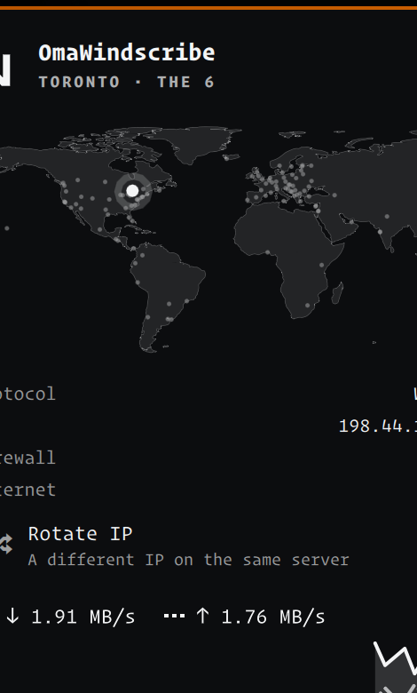

# Windscribe

**Windscribe VPN, built for Omarchy.** All of Windscribe in one bar widget
for [Omarchy](https://omarchy.org): a live world map of every city, one
click to connect, your static IPs pinned to the top, the firewall and
split tunneling in the panel, none of it in a terminal. Click the
Windscribe mark and you're protected.

*Live, and in your theme.*

## Contents

- [Why "Oma"](#why-oma)
- [New to Windscribe?](#new-to-windscribe)
- [What you need](#what-you-need)
- [Install](#install), [Update](#update), [Remove](#remove)
- [How to use it](#how-to-use-it): the bar icon, the map, quick connect,
  [static IPs](#static-ips), [profiles](#profiles), regions and cities,
  traffic, [keyboard](#keyboard)
- [How the protections work](#how-the-protections-work): the firewall,
  [always-on firewall](#always-on-firewall), [Always On](#always-on),
  [split tunneling](#split-tunneling), [Rotate IP](#rotate-ip)
- [Settings](#settings)
- [Security and privacy](#security-and-privacy)
- [Notes](#notes), [Credits](#credits), [License](#license)

## Why "Oma"

Because it doesn't look like a VPN app that landed on your desktop. It looks
like Omarchy, because it *is* Omarchy, all the way down:

- **It wears your theme.** Every colour, the font, the corner radius, the
  switches, even the Windscribe mark and the world map are drawn from
  Omarchy's theme tokens. Switch from Tokyo Night to Catppuccin Latte and
  the whole panel, coastlines, city dots, the lit city, follows on the spot.
  Nothing is a pasted-in bitmap; nothing is hard-coded.
- **It feels like the panels next to it.** The hero, the power switch, the
  rows, the hover rings, the keyboard cursor, all the same components your
  Wi-Fi, Bluetooth, and Tailscale panels are built from. Arrow keys walk
  it, `Esc` backs out, `/` finds a region. You already know how to use it.
- **It stays out of the terminal.** Install steps, sign-in, connect, pick a
  city on a map: every step is a click in the panel. The only terminals
  you'll see are Omarchy's own floating ones — the CLI install's password
  prompt and Windscribe's sign-in prompt — and both close themselves.
- **A map, without a map service.** Every Windscribe city on a world
  outline, the connected one lit and pulsing, hover for the name, click to
  open that region's city list, all from data bundled in the plugin. No
  tiles, no geocoding, no requests.
- **Fast enough to live in a bar.** The Windscribe CLI answers in about
  forty milliseconds (it's a compiled binary talking to the engine's local
  socket, not a Python interpreter), so a single status poll drives the bar
  icon, the login state, the firewall and the usage — and the panel updates
  within seconds.

It drives the official `windscribe-cli` (2.x). No API keys, no tokens, and
no credentials are stored by this plugin; your password and 2FA code go
straight into the CLI's own prompt, and Windscribe's engine owns the
session from there.

## New to Windscribe?

You don't need to be a Windscribe customer to use this. Windscribe has a
**free plan**: 10 GB a month, servers in a handful of countries, run from
Canada. The engine picks a free server for you. Pro unlocks every location
on the map, static IPs, and unlimited data — the panel tags the rows that
need it with **PRO**, and a free account's failed picks say so with the
CLI's own message.

Make a free account at [windscribe.com](https://windscribe.com), then come
back and click the Windscribe mark. Sign-in happens in the panel.

## What you need

- Omarchy
- A Windscribe account, a free one works; sign up at
  [windscribe.com](https://windscribe.com)
- The Windscribe CLI, installed as `windscribe-cli` — the panel walks you
  through it if it isn't there. On Arch (x86_64), download exactly
  `windscribe-cli_2.25.8_amd64.pkg.tar.zst` (2.25.8 is the current stable
  release) from the Linux section of
  [windscribe.com/download](https://windscribe.com/download); Windscribe
  publishes the same file on
  [their GitHub releases](https://github.com/Windscribe/Desktop-App/releases/tag/v2.25.8).
  Check it against the SHA-256 Windscribe prints in that release's notes
  ("CLI Installer Hashes") before the privileged install — never
  `pacman -U` a wildcard, which would install a stale or unrelated
  matching file just as happily — and gate the install on the check, so
  the privileged command never runs against a mismatched download:

  ```bash
  cd ~/Downloads
  echo 'c469f7cff7b747076beecc6fa811ae7de515282af39e34fcda282729ee2919b3  windscribe-cli_2.25.8_amd64.pkg.tar.zst' \
    | sha256sum -c - \
    && sudo pacman -U windscribe-cli_2.25.8_amd64.pkg.tar.zst
  ```

  `sha256sum -c` prints `OK` and only then does `pacman` run; a mismatch
  prints `FAILED`/`WARNING` and stops the chain before anything
  privileged.

  The CLI needs `nftables` and a few base packages (the package manager
  resolves them) and enables a `windscribe-helper` system service plus a
  `windscribe` user service.

That's it.

## Install

```bash
omarchy plugin add https://github.com/maplepreneur/omarchy-windscribe --enable
```

Then click the Windscribe mark in your bar. The panel walks you through the
rest:

1. **Install the Windscribe CLI** if it isn't there: the row opens a
   terminal with the exact steps — one named package file, its published
   SHA-256 verified before anything privileged (the install command runs
   only if the checksum matches), and `sudo pacman -U` on that exact file
   alone. The install itself needs your password, since it's a system
   package.
2. **Sign in**: type your Windscribe username or email in the panel and
   press Enter. A terminal opens for your password and 2FA code, then
   closes.
3. **Connect**: the switch at the top connects to the engine's best
   location, or pick a city below — or one of your static IPs.

If you'd rather place the widget yourself, drop `--enable` and run:

```bash
omarchy plugin enable io.github.maplepreneur.omarchy-windscribe right
```

## Update

```bash
omarchy plugin update io.github.maplepreneur.omarchy-windscribe
```

## Remove

```bash
omarchy plugin remove io.github.maplepreneur.omarchy-windscribe
```

That disables the widget, removes it from your bar, and deletes the plugin
folder. It leaves your Windscribe session, settings, and any active tunnel
alone; disconnect and sign out first if you want those gone too:

```bash
windscribe-cli disconnect
windscribe-cli logout
```

The widget also keeps a small folder of its own at
`~/.local/state/omarchy-windscribe/` (your profiles, your recent locations
and the icon it uses in notifications); delete it if you like.

## How to use it

### The bar icon

The Windscribe mark sits in your bar in the theme's foreground colour.
Solid means protected; dimmed means not.

| Action | What it does |
| --- | --- |
| Left-click | Open the panel |
| Right-click | Toggle: connect to the best location, or disconnect |
| Middle-click | Force a status refresh |

The panel is fully keyboard-driven too; see [Keyboard](#keyboard).

### The map

Under the header is a world map. Every dot is a city Windscribe has
servers in; the bright, pulsing one is where your traffic exits right now.
Hover a dot for its name, click it to open that city's region list.

It's drawn entirely offline. The coastlines are a single bundled outline
(Natural Earth, public domain), the dots come from a bundled list of
Windscribe's cities with their coordinates, and the connected city is
looked up in that same list by name. No map tiles, no geocoding, no
requests. A few Windscribe locations the bundled list doesn't know simply
aren't lit; nothing breaks.

The map doesn't show *your* location or draw a line to the server. Finding
your location would take a geo-IP lookup, which this plugin promises never
to make. Lighting up the exit city is the honest version. Windscribe's
"Fake" locations (Fake Mumbai, Fake Antarctica at the real Troll research
station) are drawn where they make you appear to be, which is the honest
dot too.

### The power switch

The switch at the top of the panel is the same toggle as right-click. When
off, it connects to the **engine's best location**: the same thing
`windscribe-cli connect best` does. When on, it disconnects.

### Quick connect

The first thing on the **Connections** tab, folded behind its **QUICK
CONNECT** header like the lists under it.

| Row | What you get |
| --- | --- |
| **Best** | The engine's own pick for your network. Same as the power switch. |
| **Last used** | Wherever you connected to last, or best if there's no last. |

Each row leads with a glyph that fills while that is the connection you're
on; after a shell restart the header still carries the place itself.

### Static IPs

If your account has static IPs, they get their own section right under
Quick Connect: one row per IP, named by city, the address shown so you can
check it against what a client expects. One click connects to it
(`windscribe-cli connect static <ip>`), and a static can also be saved as a
profile. The row carries a check while you're on that static.

### Two tabs: Connections and Protection

Under the connection details sit two tabs, in the same pill style as
Omarchy's network panel. **Connections** holds everywhere you can go: Quick
Connect, your static IPs, your profiles, recent places, and the region and
city lists. **Protection** holds everything about *how* you're protected:
the firewall, the always-on firewall mode, Always On, split tunneling, LAN
traffic, and your account. The tab you pick stays until you close the
panel, and `gt` flips between them from the keyboard.

The Protection tab has enough rules behind it to deserve its own chapter:
[How the protections work](#how-the-protections-work).

### Profiles

A profile is a place you've named, in a colour of your theme. "Home" in
green, "Work" in blue, "Static" in magenta: one click each. The row's dot
wears the colour and the header leads with the name while you're on it.

The **PROFILES** header folds the list away and brings it back, the same
way the region header does below. Click **New profile** and the editor
opens in place of the list:

| Field | What it takes |
| --- | --- |
| Name | Whatever you'd call it, up to 32 characters |
| Colour | One of the theme's seven names: accent, red, yellow, green, cyan, blue, magenta |
| Where | Last used, Best location, one of your static IPs, a region, or a city |

A new profile starts where you are: the top of Recent, which is the place
you last asked for. The colour is stored by name, not by value, so a theme
switch repaints every profile in the new theme's idea of blue or magenta
on its own. To change or remove one, click the pencil on its row,
right-click the row, or press `e` with the row selected. Nothing is written
until you press **Save**; `Esc` drops the draft.

Connecting through a profile records the place to Recent the same way the
row it stands for would, and Always On reconnects to that place, not to the
profile. Profiles hold *where* to connect; the firewall and the other
switches on the Protection tab are yours for every connection, so a
profile doesn't change them.

### Recent

The last three places you connected to, pinned above the region list.
Every successful connection lands here, including **Best** and
**Last used** — those don't name a destination when you click them, but
they still put you somewhere, so the place they picked is recorded by
name, and clicking it again takes you straight back. That top entry is
also what Always On reconnects to.

### Regions and cities

Below that is the full region list, folded away behind its **REGIONS**
header until you want it. The header shows the count; click it, or press
`Enter` or `→` on it, and the list opens with the filter box at its top.
`/` opens it for you on the way to the filter.

**Clicking a region doesn't connect**, it drills into that region's
cities, so you can see where you'll land before you commit.

Inside a region:

- **"Fastest in &lt;region&gt;"** is always the first row. It lets the
  engine pick any datacenter in the region, which is the same as
  `windscribe-cli connect <region>`.
- **Every row below is one city**, showing its datacenter nicknames and a
  **10 Gbps** tag when a datacenter there has it. A city temporarily
  disabled by Windscribe says so and can't be clicked.

When you pick a city, the engine connects to a random datacenter in it —
the same thing `windscribe-cli connect <city>` does. If you want a
*specific datacenter*, use the CLI: `windscribe-cli connect "New York"`.

Choosing a location is a Pro feature: the section wears a **PRO** tag on a
free account, and the CLI refuses a free account's picks with its own
message, which the panel shows under the header.

### The detail rows

When connected, the panel shows the protocol (WireGuard and its port), the
IP (marked VPN or public), the firewall state, and anything else the status
carries — exactly what `windscribe-cli status` prints. A
**Rotate IP** row asks the engine for a different IP on the same server.
If a CLI update is available, a row says so and opens a terminal that
installs it.

### Traffic

While you're connected, under the details: download and upload rates, a
60-second sparkline, and the session's totals and uptime. Download is the
filled area with a solid line; upload is the dashed line. Both are drawn in
your theme's foreground, one ink, like the rest of the panel, and told
apart by shape, not colour. Hover the sparkline to read the values at any
second.

The numbers come from the kernel's own counters for the tunnel interface
(the engine's `utun<NNN>` device), read once a second **only while the
panel is open**: so it's tunnel traffic specifically, and it costs
nothing when you're not looking.

### While a connect is in progress

A connect can take anywhere from a second (a warm reconnect) to a minute
and a half (a fresh location on a bad network). The widget doesn't freeze:
it shows "Connecting to …" and optimistically flips the switch on. If the
connect fails, the switch drops back and the reason is shown under the
header. One honest caveat: a failed connect **drops the standing
connection** (the CLI disconnects before it connects), so a typo'd
location means you're unprotected until the next connect — the panel says
so, and Always On brings the tunnel back by itself.

### Keyboard

Everything in the panel is reachable without a mouse, and the keys are Vim's.

| Key | What it does |
| --- | --- |
| `j` `k` or `↓` `↑` | Move through every section, top to bottom |
| `l` or `→` | Open the selected region's city list, unfold a list from its header, or on the tab row move to Protection |
| `h` or `←` | Back out to the region list, fold a list from its header, or on the tab row move to Connections |
| `Enter` or `Space` | Activate: connect, flip a switch, open a picker, fold or unfold a list from its header |
| `gg` / `G` | Jump to the top of the panel / the last row |
| `{` / `}` | Jump to the previous / next section |
| `Ctrl-u` / `Ctrl-d` | Move five rows up / down |
| `za` | Fold or unfold the list the selection is in |
| `zo` / `zc` | Unfold / fold that list |
| `zR` / `zM` | Unfold / fold every list |
| `gt` / `gT` | Next / previous tab, from anywhere in the panel |
| `/` | Jump to the region filter, unfolding the list if it was folded |
| `e` | Edit the selected profile |
| `q` | Close the panel |
| `Esc` | Back out one level, then close the panel |

`g` and `z` are prefixes, as in Vim: they wait a second for their second
key. There are no single-letter shortcuts that touch the tunnel, on
purpose: the panel takes keyboard focus when it opens, and a stray keystroke
should never change your connection. The letters move the selection, fold
lists, switch tabs or close the panel; `e` only opens the editor for the
profile under the selection, which changes nothing until you save.

Inside the profile editor, `j` `k` move between the fields, `h` `l` walk
the colour swatches and, on the last row, pick Save, Cancel or Delete.
`Enter` puts the cursor in the name or opens the Where picker, `Enter` in
the name field saves, and `Esc` cancels.

`Enter` on **Mode** or **Apps** opens that picker, which then owns the
keyboard: inside the Apps list, typing filters it, arrows move, `Enter`
ticks, and `Esc` closes it again.

Hover only moves the selection when you actually move the pointer.
Scrolling with the keyboard slides rows under a stationary mouse, and
without that rule the row that lands under the pointer would drag the
selection back to itself.

## How the protections work

Five switches, three owners. Knowing who owns each one explains most of
how they behave:

| Switch | Saved by | Where | Needs |
| --- | --- | --- | --- |
| **Firewall** | Windscribe CLI (`windscribe-cli firewall`) | The engine, immediately | Nothing |
| **Always-on firewall** | This widget, editing Windscribe's file | `~/.config/Windscribe/windscribe_cli.conf` | Nothing |
| **Always On** | This widget | `~/.local/state/omarchy-windscribe/state.json` | Nothing |
| **Split tunneling** | This widget, editing Windscribe's file | `~/.config/Windscribe/windscribe_cli.conf` | Nothing |
| **Allow LAN traffic** | This widget, editing Windscribe's file | `~/.config/Windscribe/windscribe_cli.conf` | Firewall on to matter |

### Firewall

Blocks all traffic outside the VPN. Out of the box the engine runs it in
**Auto** mode: the firewall comes up *before* the tunnel connects and goes
down with the tunnel, so the dangerous moment — a dropped tunnel with
your traffic silently falling back to the plain connection — is exactly
the moment it covers.

The toggle turns the firewall on or off **right now**, which mostly
matters while you're disconnected: on means nothing leaves this machine
until the VPN is up, useful on hostile Wi-Fi.

While the firewall is on, Tailscale-style direct device-to-device traffic
is blocked too — a kill switch with a hole in it isn't a kill switch, so
it's a choice: firewall on and Windscribe owns everything, or firewall
off and your tailnet runs alongside.

### Always-on firewall

The mode behind the firewall: **Auto** (on while connected, the default)
or **Always On** (never goes down, even when the VPN is off — a true kill
switch). With Always On set, the engine refuses `firewall off`, so the
Firewall row locks and says which switch to change first.

### Always On

Whenever Windscribe isn't connected, connect it. That covers booting,
logging in, joining a café Wi-Fi, a tunnel that drops on its own, and a
dropped-after-a-failed-pick connect: they're all just moments when you
aren't protected and should be. It's checked on the same few-second poll
that drives the bar icon, so there's nothing extra running. **Off by
default.**

It reconnects to the top of your **Recent** list, which is the place you
were last actually on. If that attempt fails, the next one falls back to
the engine's best location, so it can't get stuck retrying a place that
isn't coming back. A connect that fails waits thirty seconds before trying
again, so a dead network doesn't get hammered.

Two things worth knowing:

- It never fires while you're signed out, and it will never open a
  sign-in terminal on its own.
- While it's on, **Disconnect** won't keep you disconnected; you'll be
  reconnected within a few seconds. Switch Always On off if you want to
  stay off.

Always On and the firewall are different answers to the same question. The
firewall stops traffic leaking *while* the tunnel is down; Always On
makes the tunnel come *back*. Together they close the gap from both
sides: nothing leaks, and you're not stuck offline.

### Split tunneling

Turn it on and two more rows appear: **Mode**, and the **Apps** list.

- **Exclude** (the default) sends the apps you pick out through your
  normal connection; everything else stays on the VPN. Good for a bank
  that blocks VPN IPs, or a device on your own network.
- **Include** is the mirror image: only the apps you pick go through the
  VPN, and everything else uses your normal connection.

The Apps list is every desktop app on the machine that the widget can
point at a real program on disk. Search it, tick what you want, untick to
remove.

How Windscribe does it, so the caveats make sense: while split tunneling
is active, the engine watches every program you start and routes the
connections of the ones you picked around the tunnel, or through it in
Include mode. Which is why:

- **Restart your apps after connecting.** Connections are routed as
  they're made, so anything already running when the tunnel came up keeps
  using it until you restart it.
- **Flatpaks and Snaps aren't listed.** They all launch through one shared
  runner, so picking one would pick all of them. Same for anything that
  launches through a terminal chooser or a web-app handler.

Windscribe's own GUI reads and writes the same settings file this widget
edits, with the same string-list encoding — the one Qt's settings parser
defines — so the two stay in agreement whichever one you change it from.
An app path containing a comma, quote or space stays one entry under that
encoding, not several.

### Rotate IP

Connected, the detail rows include **Rotate IP**: a different IP on the
same server, without dropping the tunnel. It's for keeping a fresh address
without losing your session, and it needs Pro or the location in your
plan; a rotation still in progress reports nothing rather than an error.

### Which setup do I want?

| You want | Firewall | Always-on firewall | Always On |
| --- | --- | --- | --- |
| Everything private, always. The default recommendation. | Auto | Off (Auto covers the tunnel) | On |
| Nothing in or out, ever, even offline | On | On | On |
| Everything private, except one app that refuses to work over a VPN | Auto | Off | On |
| Nothing automatic; I connect by hand | — | — | Off |

For the first row, Auto mode already covers the tunnel's lifetime; the
second row is the only one that needs Always On, and it's the one to pick
if the machine ever sits on hostile networks while disconnected.

### Account and sign out

Below the switches, **Account** shows this month's data usage and the
plan, with a **Sign out** row. It asks for a second click within five
seconds, because signing out also disconnects.

### Notifications

If the VPN drops unexpectedly you get a desktop notification, "VPN
Disconnected, You're no longer protected." Connecting shows "VPN
Connected" with the place. Both go out as low urgency, so Omarchy's
shell fades them out after about five seconds instead of parking them
in the corner; a critical toast would wait for a click. Neither shows
while the panel is open, since the panel already tells you. Turn both
off in the widget's settings if you'd rather not.

## Settings

Configurable from Omarchy's widget settings:

| Setting | Default | What it controls |
| --- | --- | --- |
| Desktop notifications | On | "VPN Connected" with the place on connect; "VPN Disconnected" if the tunnel drops unexpectedly. Not shown while the panel is open. |
| Status watch interval | 4 s | How often `windscribe-cli status` is polled. The CLI answers in ~40 ms, so this is cheap. |

## Security and privacy

This plugin runs unsandboxed inside the Omarchy shell process, like every
Omarchy plugin. It:

- stores no credentials, tokens, or account data (the CLI never even
  prints the account name — the panel shows only usage and plan)
- makes **no network requests of its own, ever**: the world map is
  bundled, the city list is bundled, everything live comes from the
  engine's local socket
- never asks for root; the CLI install runs through Omarchy's own floating
  terminal, which owns the password prompt
- never downloads or executes remote code (the **Update** row hands the
  CLI's own `update` command to a terminal rather than running it itself)
- runs every command as an argument list, never through a shell, with one
  exception below
- reads the tunnel's byte counters under `/sys/class/net/utun*/` once a
  second while the panel is open, and writes two files of its own under
  `~/.local/state/omarchy-windscribe/` (`state.json`: your profiles,
  recent location labels, fold states, and whether Always On is on;
  `notification-icon.svg`: the Windscribe mark in your theme's colour)
- writes one file that isn't its own, and only when you flip a switch that
  the CLI has no command for: `~/.config/Windscribe/windscribe_cli.conf`,
  Windscribe's own settings. Rules below.

**Sign-in.** Your password and 2FA code go straight to the CLI's own
prompt in a terminal; this plugin never sees them. The username you type
in the panel is the one value that has to cross a shell boundary
(Omarchy's terminal launcher takes a command string). It's checked against
a strict allow-list — letters, digits, and `. _ + @ -` only — and
single-quoted before it goes anywhere; anything else is refused with a
message, not escaped.

**Settings writes.** The always-on firewall, split tunneling, the app
list and LAN traffic live in Windscribe's INI settings file, which the
engine watches and applies as soon as it's saved — and which it rewrites
itself whenever its own state changes. Every save therefore goes through
one bundled helper (`confedit.py`, stdlib-only Python like the other two)
rather than the shell's cached copy of the file. What that means in
practice:

- It only ever happens when you flip one of those switches. Nothing is
  written on start-up, on a poll, or when you connect.
- The helper reads the file from disk at the moment of the edit, so a
  newer change the engine just saved can't be reverted by a stale copy.
  The commit is an atomic compare-and-swap where Linux allows it
  (`renameat2` with `RENAME_EXCHANGE`): the staged file and the conf
  file swap names atomically, and the displaced file tells the helper
  exactly what its edit replaced. If that is the engine's newer save,
  it is put back on the active file — the one Windscribe reloads —
  before the edit is staged again, so a failed merge does not leave
  that save only in a side file. If overlapping saves exhaust the merge
  attempts, the newest displaced snapshot is journaled beside the conf
  file; a later run publishes it to the active file before it is
  allowed to report success, and will not claim an older preferences
  file while that save is still sitting unread. A displaced copy is
  never deleted if the helper could not read it. Success means the
  active file is the newest observed content plus the one change. A
  save landing after the commit is caught by the whole-file read-back
  and reconciled the same way. Where the exchange is unavailable, the
  helper falls back to a last identity check back to back with the
  rename — a microsecond gap, no wider than the window the engine's own
  writer accepts on every save — and the docstring says what that
  leaves open.
- The edit is surgical and per-setting: exactly one `Key=value` line
  changes, and every other byte of the file — section order, unknown
  keys, spacing — comes back exactly as found. A diff before and after a
  change shows the one line and nothing else, not even an extra
  newline.
- After writing, the helper verifies the whole file is exactly the
  intended edit and reads the key back, so the rows confirm the value
  the engine actually has. If the engine kept replacing the value in the
  same instant, the row says so rather than pretending the click took.
- If the file, section or key is missing, nothing is written and the row
  says Windscribe hasn't written its settings yet. The widget never
  creates the file.
- App paths only ever come from the widget's own scan of installed apps,
  and anything that isn't an absolute path is dropped rather than
  repaired. The list is written with the string-list encoding Qt's own
  settings parser defines, so a path with a comma, quote or space in it
  stays one entry under the engine's reader, not several.
- Writes are atomic (written aside in the same directory, then renamed
  into place with the file's permissions kept), so an interrupted write
  can't leave you with half a settings file.
- Nothing is written while a CLI action is running, and saves queue
  behind one another with the last one winning, so two of ours can't
  land on the file at once either.

**What's visible to other processes.** Omarchy exposes every plugin over
a Quickshell IPC socket under `/run/user/<uid>/`, which only your own user
(and root) can reach. Through it, any process running as you can call this
widget's `connect`, `disconnect`, `connectCity`, `connectStatic`,
`firewall`, `splitTunnel`, `status`, and `debug` methods — the same
things that process could already do by running `windscribe-cli`
directly. Note that while Always On is enabled, an IPC `disconnect` is
undone within a few seconds, same as the button. `debug` carries no
secrets: only state flags, counts, and the last error.

**The CLI's own lock.** The CLI refuses to run two copies of itself at
all ("Windscribe CLI is already running"), so every call this widget
makes — from every monitor's copy of the widget, and from the sign-in
terminal — takes one lock file in `$XDG_RUNTIME_DIR` first and the calls
queue instead of overlapping. A probe that finds the lock held treats it
as "ask again next poll", never as a failure; if you run `windscribe-cli`
in a terminal at the same moment, the same courtesy applies in reverse.

**Notifications** are sent straight to the desktop notification service
over D-Bus and contain only the connection state and the place.

## Notes

**How state is detected.** One `windscribe-cli status` (~40 ms) on a short
timer answers everything: login, connection, firewall, usage, the IP.
Connects are optimistic — the switch flips when you ask, and the next
poll confirms or rolls it back — because a connect legitimately takes up
to a minute and a half. `status` while a connect is in flight reports the
old state, and the panel says "Connecting…" over it until the answer
lands.

If the engine stops answering altogether — three polls in a row with no
answer — the widget stops claiming anything: the bar drops its protected
look, the hero and the IPC `status` read "Status unknown", and a
notification fires if the bar was claiming protection at the time. The
unknown state never reads as "not protected": an engine that isn't
answering could have a tunnel up that can't be seen. A fresh poll that
lands repopulates everything.

**More than one monitor.** The bar draws one copy of the widget per
screen, and the engine would refuse the overlapping CLI runs, so every
call takes the lock file described above. When Always On reconnects, the
first screen to get the lock does it and the rest see the tunnel come
back. A monitor whose probe finds the lock held tries again on its next
poll.

**Where the city list comes from.** `windscribe-cli locations` prints
every datacenter (region, city, nickname, 10 Gbps/Pro/Disabled flags); the
panel collapses that into one row per city and one section per region,
and the map dots come from a bundled list of those cities with
coordinates, generated once and shipped in the plugin. A city Windscribe
adds later that the bundle doesn't know still connects fine from the
drill list; it just isn't lit on the map until the bundle updates.

## Credits

The world outline is [Natural Earth](https://www.naturalearthdata.com/)
1:110m land data, free, public-domain map data made by volunteers, and the
reason this widget can draw a map without calling anyone. Projected once
into `World.js`. The Windscribe W is drawn from Windscribe's own public
logo and recoloured to the active theme, so it isn't a scaled bitmap.
This plugin's panel architecture, keyboard model, and safety discipline
are adapted from [OmaProton VPN](https://github.com/grichard99/omaproton-vpn)
by grichard99 (MIT) — thank you. Windscribe is a trademark of Windscribe
Limited. This is an unofficial community plugin and is not affiliated with
or endorsed by Windscribe.

## License

[MIT](LICENSE)
